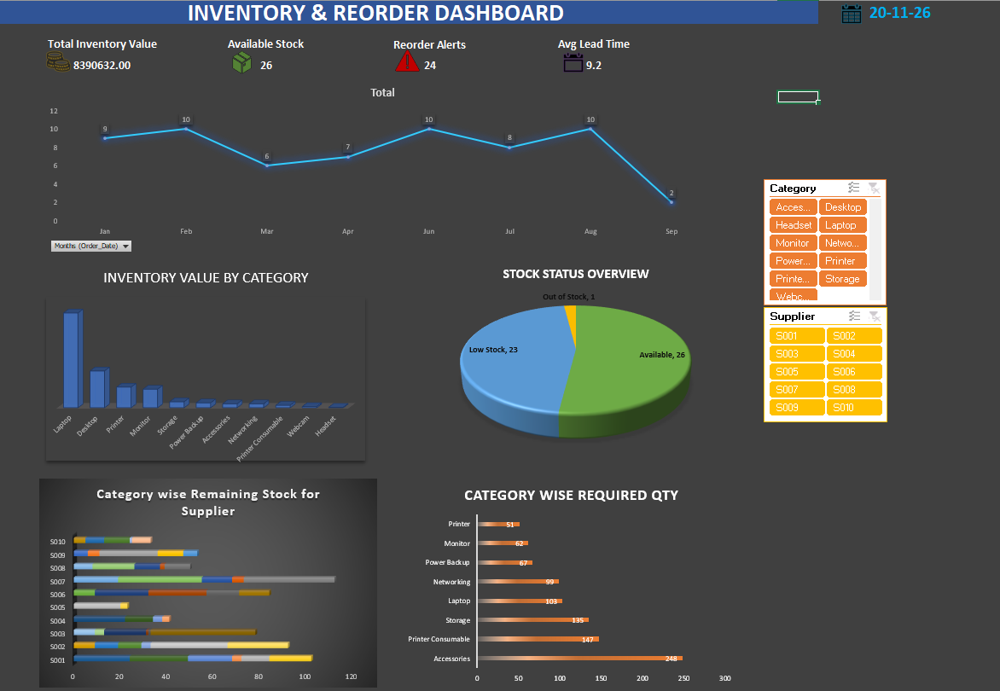

# Inventory & Order Tracking Automation (Excel VBA)

*The inventory and reorder dashboard: inventory value, available stock, reorder alerts, average lead time, and slicers by category and supplier.*

A macro-enabled Excel workbook that runs inventory and order tracking end to end: product, supplier and order entry through validated VBA-driven entry sheets, formula-driven stock and reorder calculations, and PivotTable dashboards for inventory value, reorder alerts and order status.

## What it does

- **Data entry with guardrails.** VBA-driven entry sheets for product, supplier and order entry, with required-field and numeric validation, sequential ID generation, and save/clear actions.
- **Stock and reorder logic.** INDEX/MATCH, SUMIFS and IF formulas calculate delivered quantities, remaining stock, inventory value, low-stock alerts and replenishment quantities against per-product reorder thresholds.
- **Dashboards.** Two PivotTable-based dashboards with charts and slicers covering inventory value, stock availability, reorder alerts, supplier lead times and delivered vs pending orders.

## Data model

Structured Excel tables link **50 products**, **10 suppliers** and **250 order records** across 14 sheets, so every entry flows through to stock positions, reorder reports and dashboards without manual rework.

## Download

[Download the workbook (.xlsm)](https://github.com/SajanaLal/excel-inventory-order-tracking/raw/refs/heads/main/Inventory%20Management%20System_Sajanalal%20H.xlsm)

The file is macro-enabled, so your browser or Excel may flag the download. That is normal. Enable macros to use it: the macros are the product, supplier and order entry forms plus the reorder report filter.

All data in the workbook (products, suppliers, customers and orders) is invented sample data.

## Tools

Excel (structured tables, PivotTables, PivotCharts, slicers, conditional formatting), VBA (entry-form macros, report filter macro)

## Why it matters

This mirrors the day-to-day of procurement and inventory analysis: keeping master data clean, knowing what to reorder and when, and giving planners numbers they can trust.
